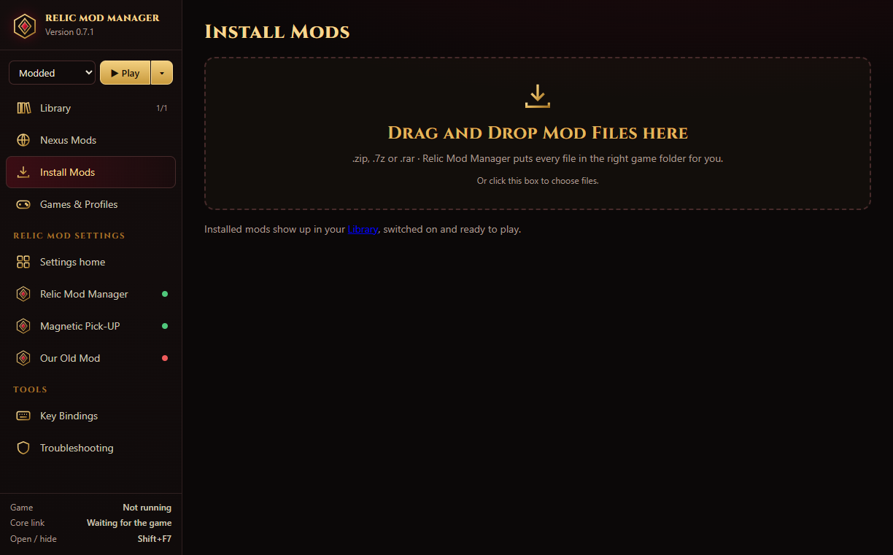
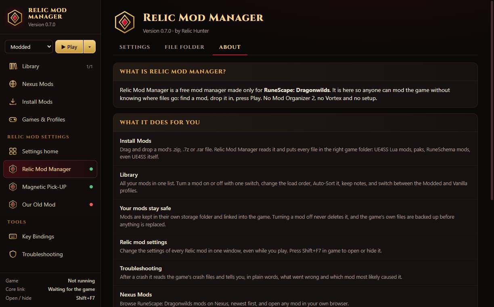

# Relic Mod Manager

A simple, free mod manager made only for **RuneScape: Dragonwilds**.
Find a mod, drop it in, press Play. No Mod Organizer 2, no Vortex, no setup.

## What it does

- **Install Mods**: drag and drop a mod's `.zip`, `.7z` or `.rar`. Every file goes to the right game folder: UE4SS Lua mods, paks (`~mods`, LogicMods), RuneSchema mods, even UE4SS itself.
- **Library**: all your mods in one list. Turn a mod on or off with one switch, change the load order, Auto-Sort it, add notes, and switch between the **Modded** and **Vanilla** profiles.
- **Your mods stay safe**: mods live in their own storage folder and are linked into the game. Turning a mod off never deletes it, and game files are backed up before anything is replaced.
- **Relic mod settings**: change the settings of every Relic mod in one window, even while you play (**Shift+F7** in game).
- **Troubleshooting**: after a crash it reads the game's crash files and says, in plain words, what went wrong and which mod most likely caused it.
- **Nexus Mods**: browse RuneScape: Dragonwilds mods on Nexus, newest first, and open any mod in your own browser.

## Install

1. Install **UE4SS v4.0.0** for Dragonwilds ([Nexus mod 935](https://www.nexusmods.com/runescapedragonwilds/mods/935)).
2. Download Relic Mod Manager from [Nexus Mods](https://www.nexusmods.com/runescapedragonwilds/mods/916) and unzip the `RelicCore` folder into
   `RSDragonwilds\Binaries\Win64\ue4ss\Mods\`.
   Or use the stand-alone zip: unzip the `Relic Mod Manager` folder anywhere and run `RelicModManager.exe`.
3. Start the game (it opens at the main menu) or run `RelicModManager.exe`.

Needs Windows 10 or 11 (Microsoft Edge WebView2 and .NET Framework 4.8 are already part of Windows).

Windows may say "Windows protected your PC" the first time: the app isn't code-signed. Click **More info**, then **Run anyway**.

## Build from source

- .NET SDK 8 (builds the .NET Framework 4.8 app), Python 3.
- `py tools/build.py` builds the app and writes both zips.
- Tests: `dotnet build -c Release` in `tests/ManagerTests`, then run `ManagerTests.exe`. The Lua tests (`tests/test_core.py`) need `lupa`.

## Layout

| Folder | What's in it |
|---|---|
| `src/app` | The Windows app (C#, WinForms + WebView2) and the mod manager (`Manager/`) |
| `src/ui` | The window's pages (HTML/CSS/JS) |
| `lua` | The UE4SS side: starts the window with the game, shares settings with Relic mods |
| `tests` | Manager tests (C#) and Lua tests (Python + lupa) |
| `tools` | Build script and icon maker |

## Help

Questions, bugs and new mods: the Relic Mods Discord, https://discord.gg/BumVNYDUec

Made by Claude Ai & Relic Hunter
